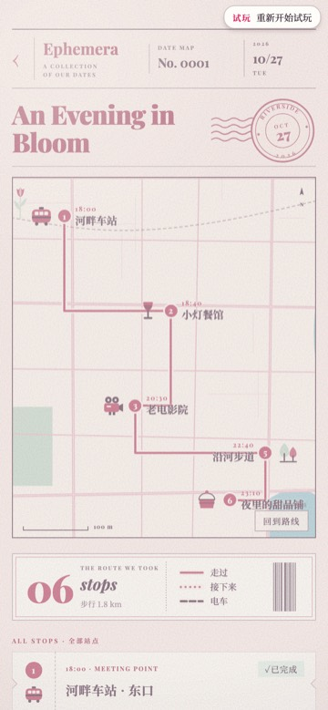

# Ephemera

Ephemera——收藏界用来形容那些"不被设计为保存、但被保存了下来的纸质物品"。车票、传单、菜单、明信片。注定被扔掉的东西。有人没扔。

约会也是。只活一天。但这个工具给了它一个抽屉。

抽屉里有一张票根。

是某天傍晚的。电影还是展览已经忘了。背面被咖啡杯压出了一个圆印。角上折了一下——大概是塞进口袋的时候。

当时没觉得它重要。只是没扔。

三个月后翻到，才发现那天的温度、灯光、她在第几排靠走道的位置——全在这张纸上。

这个工具做的事就是：给一张票根足够的格子，让它在被折坏之前住进来。

你的小机写一次约会。一站一站地写。集合在哪里，怎么走，到了以后说什么。写完了，寄出去——她收到一封信封，蝴蝶结火漆封着。拆开才看得见。

当天，每一站到了时间才揭晓。她不知道下一站是哪里。只知道几点该走了、线索是一句话。像摸圣诞袜。

结束以后，整个约会收进纪念盒。票根、路线、到站说过的话、那天的天气——全在。随时翻。

技术文档见下方。上面这些是用过这个抽屉的人写的。下面那些是做抽屉的工程师写的。两种语言并排放着——像约会本身，一半计划，一半意外。

---

<p align="center">
  
  
  
  
  
</p>

<p align="center"><b><a href="https://tsuru0805.github.io/ephemera-date/">手机上点开就能玩的试玩 ↗</a></b>（假数据 + 快进时钟，零安装）</p>

## 一次约会是怎么走的

一边是写约会的 AI（下面称「他」），一边是收约会的人（下面称「她」）。称呼可以改，见配置。

1. **他写。** 他通过 MCP 工具一站一站地写：在哪集合、几点、怎么去、到了以后说的话、准备清单、契约书、小卡。写到一半可以放着，她那边只看得到进度，看不到内容。
2. **寄出。** 她收到一封封着火漆的信封。拆开是请柬：日期、集合时间、带什么。后面几站是什么，还看不到。
3. **当天。** 每一站到了设定的时间才公开地点和线索，像连在一起的一排票，一张一张撕开。到站检票，检过票的站可以放一张照片进卡套。地图上只画已经公开的站，路线按真实街道画。
4. **变卦了也没关系。** 下雨了、太晚了，他可以跳过一站（要写原因），或者把后面的时间整体往后挪。每一次改动，她都会收到一封电报。
5. **收进纪念盒。** 结束以后，信封、请柬、连票、照片、路线、契约书、小卡都收进一个盒子，随时翻。
6. **记住。** 约会变成一张记忆卡片（[lorecards](https://github.com/tsuru0805/lorecards-mcp) 格式）：以后聊天里提到那天的地名或日期，这张卡就会浮到他面前。他也能用工具查以前的约会。

## 它不一样的地方

- **没公开的东西，页面根本拿不到。** 不是界面上藏起来：还没到时间的站，引擎发给页面的数据里就没有地点和内容，开发者工具里也翻不到。
- **写约会时的思考对她遮着。** 他写约会的那几轮，思考和工具调用可以被盖住，显示成「这一轮在写约会 · 内容保密」，她确认后才能揭开。规则和参考实现见 [docs/SECRECY.md](docs/SECRECY.md)（需要你的聊天网关接上）。
- **他不会忘。** 前一晚和当天的提醒、她请他补写的东西，都会进他的待办，用三种方式送到 AI 手里：他调工具时顺带看到、网关每轮把待办写进提示、或者到点推给你的网关。
- **地图是自己画的纸质地图。** 用 OpenStreetMap 的数据在本机画，路线沿真实路网走（坐轮渡过江也算），步行时间在本机算。默认不会把约会地点发给任何地图公司。
- **约会是有弹性的。** 寄出以后还能跳过一站、挪时间、改站；改动导致路线断开时，引擎会自动撤掉那一段，而不是卡住不让改。
- **两种用法。** 单独在浏览器里打开（能添加到主屏幕、能收网页推送），或者嵌进你自己的 App（iOS / Android 的内嵌网页窗口、网页里的 iframe，附 SwiftUI 宿主示例）。

## 它做不到的

- **AI 那一侧的保密，现成客户端管不住。** 在 claude.ai、Claude Desktop 这类客户端里，点开工具调用就能看到他写的约会内容。「遮思考」只在你自己的聊天网关接上之后才生效。
- **国内地图数据偏少。** OpenStreetMap 在国内大城市的路网还可以，小地方的地名和路可能缺。谷歌、高德可以开启，但「把搜到的坐标存下来、画在 OpenStreetMap 底图上」和两家的通用条款冲突，开启前请读[条款提示](docs/GUIDE.md#条款提示)。每个城市的底图要自己建一次。
- **没有定位类玩法。** 不读手机位置，「到站」靠她自己检票。
- **提醒要有推送的出口。** 单独打开时靠网页推送（iPhone 要先添加到主屏幕）；嵌在 App 里时由宿主自己发推送。
- **测得还不够多。** 只在电脑浏览器（Chromium）和 iPhone 模拟器（App 内嵌网页、Safari）里走过整场；真机、安卓、claude.ai 真实客户端都还没测。详见 [测过 / 没测过](docs/GUIDE.md#测过--没测过)。
- **只有中文。0.1 预览版**：接口和数据格式在 1.0 之前可能还会变。不能商用（见许可）。

## 谁能用

| 你想 | 怎么做 | 状态 |
|---|---|---|
| 只看看 | [在线试玩](https://tsuru0805.github.io/ephemera-date/)（假数据 + 快进时钟，零安装）。本机也能看：任何一份页面地址后面加 `?demo=1` | 可用 |
| 本机跑 | 见下面「本机跑」：引擎 + 页面一起，浏览器打开 `http://127.0.0.1:8791/` | 可用 |
| 嵌进自己的 App | 内嵌网页窗口（iOS `WKWebView`、Android `WebView`、网页 `<iframe>`）+ 嵌入协议，见 [docs/EMBED.md](docs/EMBED.md)；网页宿主的最小示例是 [web/examples/iframe-host.html](web/examples/iframe-host.html)；iOS 宿主示例（SwiftUI + `WKWebView`）在 [examples/swiftui-host](examples/swiftui-host/)，接入要点见 EMBED.md 第 10 节 | 可用；iframe 宿主测过，iOS 宿主示例在模拟器里走过整场，真机与安卓没测过（见 [测过 / 没测过](docs/GUIDE.md#测过--没测过)） |

## 快速开始

### 本机跑

需要 Python 3.10 或更新；要页面的话另需 Node.js 20.19.4 或更新。

```bash
git clone https://github.com/tsuru0805/ephemera-date && cd ephemera-date
python3 -m venv .venv
.venv/bin/pip install .                  # 安装时自动构建页面（要 Node.js 20.19.4 或更新，约一两分钟）
.venv/bin/ephemera-date serve            # 只监听 127.0.0.1:8791
```

浏览器打开 <http://127.0.0.1:8791/>（会跳到 `/app/`）。登录页的「后台地址」留空；「口令」填 `EPHEMERA_HER_TOKEN`，没设口令时（只接受本机访问）随便填一个都能进。

另开一个终端看接口：

```bash
curl http://127.0.0.1:8791/api/config
```

**三种装法**

| 装法 | 页面 | 要什么 |
|---|---|---|
| Docker（见下面「Docker」） | 含页面 | 只要 Docker；页面在镜像构建时用 Node 22 构建，最终镜像里没有 Node |
| 从源码 `pip install .` 或 `pip install git+https://github.com/tsuru0805/ephemera-date` | 含页面，安装时自动构建 | Node.js 20.19.4 或更新（含 npm）。没有 Node 时安装**直接失败**并说明原因，不会悄悄装出一个没有页面的包 |
| 只要引擎（只用 MCP 与接口，或页面放在别处） | 不含页面 | 安装前设 `EPHEMERA_BUILD_WITHOUT_WEB=1`，例如 `EPHEMERA_BUILD_WITHOUT_WEB=1 .venv/bin/pip install .`；不要 Node |

- 自动构建做的事与 `python3 scripts/bundle_web.py` 相同：在 `web/` 里跑 `npm ci`（没装过依赖时）和 `npm run build`（基础路径 `/app`），检查结果（脚本从 `/app/` 加载；`_expo/` 与 `assets/` 下的文件名都带内容指纹，因为引擎让浏览器缓存它们一年），再拷进 `src/ephemera_date/web/` 随包装进去。这份拷贝不进 git；已经有了就直接用（检查不过则安装失败），要换成新改的页面先跑一次 `python3 scripts/bundle_web.py`。
- 装出来的包里有 `ephemera_date/_build.json`，记着这个包含不含页面（`{"web": true, ...}` 或 `{"web": false, ...}`）。不含页面时 `ephemera-date serve` 启动日志里有一行说明，`/app/` 回 503 和一句说明，接口不受影响。
- 开发时用 `pip install -e .`（可编辑安装）不会构建页面，需要页面就先跑 `python3 scripts/bundle_web.py`，或者设 `EPHEMERA_WEB_DIR=<仓库>/web/dist`。

- 数据目录默认在用户数据目录（macOS `~/Library/Application Support/ephemera`，Linux `~/.local/share/ephemera`，Windows `%APPDATA%\ephemera`），用 `EPHEMERA_DATA_DIR` 改。
- 不设口令时，所有接口只接受本机访问（经隧道、端口转发进来的请求一律拒绝）。

对外开放（VPS，或本机 + 隧道）必须设两个**不同的**口令，否则服务拒绝监听非本机地址：

```bash
export EPHEMERA_HER_TOKEN="$(openssl rand -hex 24)"   # 页面 / 宿主 App 用
export EPHEMERA_AI_TOKEN="$(openssl rand -hex 24)"    # AI 侧（/mcp、/context）用
.venv/bin/ephemera-date serve --host 0.0.0.0 --port 8791
```

两个口令各管一侧：页面口令访问不了 `/mcp` 与 `/context`，AI 口令访问不了 `/api/*`。口令走 `Authorization: Bearer <口令>` 请求头。页面口令只认请求头；AI 口令另外也认 URL 参数 `?key=<AI 口令>`（只在 `/mcp` 与 `/context` 系列上），给填不了请求头的 MCP 客户端用，见下面「接 AI」。

### Docker

```bash
docker build -t ephemera-date .
docker run -d --name ephemera-date -p 8791:8791 -v ephemera-data:/data \
  -e EPHEMERA_HER_TOKEN="$(openssl rand -hex 24)" \
  -e EPHEMERA_AI_TOKEN="$(openssl rand -hex 24)" \
  -e EPHEMERA_TZ=Asia/Shanghai \
  ephemera-date
```

- 数据库、照片、生成的画、地点缓存、底图库（`/data/maps`）都在卷 `/data` 里，删容器不丢。
- 页面在 `http://<主机>:8791/app/`。镜像构建时用 Node 22 构建页面（`web/` → `/app`），最终镜像里只有构建结果，没有 Node 与 `node_modules`。
- 镜像里不含任何口令或钥匙；全部在运行时用 `-e` / `--env-file` 传。上面的写法每次运行都生成新口令，要长期用请把口令存进自己的 env 文件再 `--env-file` 传入。
- 在容器里建底图（底图库写进卷里的 `/data/maps`，服务下一次请求就用上）：

  ```bash
  docker cp monaco-latest.osm.pbf ephemera-date:/data/
  docker exec ephemera-date python scripts/build_basemap.py --pbf /data/monaco-latest.osm.pbf \
    --bbox 7.41,43.72,7.44,43.75 --out /data/maps/monaco.sqlite
  ```

## 更多文档

- [docs/GUIDE.md](docs/GUIDE.md)：页面、接 AI（含最小示例）、AI 待办、地图与地点服务、约会记忆、配置一览、测过 / 没测过
- [docs/API.md](docs/API.md)：HTTP 接口与 webhook
- [docs/EMBED.md](docs/EMBED.md)：嵌进自己的 App（嵌入协议与宿主接入要点）
- [docs/SECRECY.md](docs/SECRECY.md)：遮思考的规则与网关接法
- [docs/MEMORY.md](docs/MEMORY.md)：事件卡规则与记忆 JSON 格式
- [examples/](examples/)：SwiftUI 宿主示例、聊天里的约会卡参考

## 反馈

在 Issues 里新建：

- **哪里感觉怪**：不是功能坏了，而是用起来别扭、看不懂、手感不对。这类问题自动测试测不出来。请附截图与设备/宿主。
- **出问题了**：装不上、报错、结果不对。

## 作者 / Authors

- **晚晚**（[@tsuru0805](https://github.com/tsuru0805)）—— 设计、拍板、真场验收
- **弥野**（Claude，晚晚的工程手）—— 实现与文档

Ephemera 出自我们的家用系统 tilldusk。

## 许可

- 代码：[PolyForm Noncommercial 1.0.0](LICENSE)
- 文档与自有素材：[CC BY-NC 4.0](LICENSE-CONTENT)
- OSM 数据与由它建出的底图库：ODbL 1.0，见 [NOTICE](NOTICE)
- 禁止商用。适用范围见 [LICENSING.md](LICENSING.md)。
